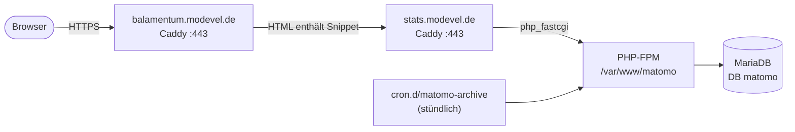

# Matomo: Reichweitenmessung auf dem eigenen Server

Runbook für die cookielose Reichweitenmessung von Website und Web-App mit Matomo auf demselben
Hetzner-Host wie Balamentum. Die Datenschutzerklärung ([`website/src/privacy.ts`](../website/src/privacy.ts))
verspricht dazu: cookielos, IP-Kürzung auf 2 Bytes, Löschung der Rohdaten nach 180 Tagen,
Beachtung von Do Not Track — die Instanz ist so eingestellt, dass sie das einlöst. Verdrahtet ist
das Client-Tracking komplett im Repo (`frontend/src/lib/matomo.ts`, Website-Build in
[`website/scripts/build.ts`](../website/scripts/build.ts), Vite-Plugin in
[`frontend/vite.config.ts`](../frontend/vite.config.ts), Seitenaufrufe der App in
`frontend/src/lib/tracking.ts`); die Android-App zählt mit (Kanal `android`).
Aktiviert wird das Snippet allein über die GitHub-Variablen `MATOMO_URL` und `MATOMO_SITE_ID`
([`deployment.md` § 3](deployment.md)).



> **Zustand der Instanz (seit 2026-10-18):** Matomo 5.14.1, Ubuntu 26.04, PHP 8.5-FPM,
> MariaDB 11.8, Subdomain `stats.modevel.de`, eine Site „Balamentum" mit **Site-ID 1**
> (Website + App gemeinsame Site, `/app/` trennt im Bericht). Admin-Login: `admin` — E-Mail und
> Passwort beim ersten Login ändern.

---

## 1. DNS

A-Record für die Subdomain auf die Server-IP setzen, sonst kann Caddy kein TLS-Zertifikat holen:

| Zone         | Typ | Name    | Wert             |
| ------------ | --- | ------- | ---------------- |
| `modevel.de` | A   | `stats` | `167.233.90.149` |

Die Zone liegt bei IONOS (`ui-dns.*`); der Record wird dort in der Domain-Verwaltung angelegt.
Danach Caddy einmal neu laden (`systemctl reload caddy`), falls das Zertifikat schon vergeblich
angestoßen wurde — Caddy versucht die Ausstellung sonst im Hintergrund weiter.

## 2. Pakete

```bash
sudo apt update
sudo apt install -y php8.5-fpm php8.5-mysql php8.5-curl php8.5-gd php8.5-xml php8.5-mbstring php8.5-intl unzip mariadb-server

# Archivierung braucht mehr als die 128M-Decke von PHP-FPM
echo 'memory_limit = 256M' | sudo tee /etc/php/8.5/fpm/conf.d/99-matomo.ini
sudo systemctl restart php8.5-fpm
```

## 3. Datenbank

```bash
PW=$(openssl rand -base64 24)
sudo mariadb <<SQL
CREATE DATABASE matomo CHARACTER SET utf8mb4 COLLATE utf8mb4_unicode_ci;
CREATE USER 'matomo'@'localhost' IDENTIFIED BY '$PW';
GRANT ALL PRIVILEGES ON matomo.* TO 'matomo'@'localhost';
DELETE FROM mysql.global_priv WHERE User='';
DROP DATABASE IF EXISTS test;
FLUSH PRIVILEGES;
SQL
```

DB-Zugang und Matomo-Admin liegen unter `/root/matomo-credentials.env` (chmod 600) — dieselbe
Ablagekonvention wie die übrigen Server-Secrets.

## 4. Matomo beziehen

```bash
cd /tmp
curl -fsSL -o matomo.zip https://builds.matomo.org/matomo.zip
sudo unzip -qo matomo.zip -d /var/www/
rm -f "/var/www/How to install Matomo.html" /tmp/matomo.zip
sudo chown -R www-data:www-data /var/www/matomo
```

Das Release-Zip bringt bereits eine `robots.txt` mit, die alle Crawler aussperrt — die
Statistik-Subdomain bleibt so aus Suchmaschinen draußen.

## 5. Caddy-Block

```bash
sudo tee -a /etc/caddy/Caddyfile >/dev/null <<'EOF'

# --- Matomo (Reichweitenmessung, cookielos) — siehe docs/matomo.md ---
stats.modevel.de {
	root * /var/www/matomo
	encode zstd gzip

	header {
		Strict-Transport-Security "max-age=31536000"
		X-Content-Type-Options nosniff
		-Server
	}

	# Matomo-Interna nicht ausliefern (Spiegel der offiziellen nginx-Regeln)
	@interna path /config/* /tmp/* /core/* /lang/* /misc/* /vendor/* /node_modules/* /tests/*
	respond @interna 404
	@htaccess path *.htaccess
	respond @htaccess 404

	php_fastcgi unix//run/php/php8.5-fpm.sock
	file_server
}
EOF

sudo caddy validate --config /etc/caddy/Caddyfile
sudo systemctl reload caddy
```

TLS holt Caddy automatisch (Let's Encrypt), sobald der DNS-Record aus Schritt 1 auflöst.

## 6. Installer

Der Matomo-Installer läuft im Browser über die Subdomain (Schritte: Willkommen → System-Check →
Datenbank → Tabellen → Superuser → Website → Tracking-Code → fertig). Bevor die Subdomain per DNS
erreichbar ist, geht er auch über einen temporären Loopback-Block:

```bash
# temporaer nur auf localhost binden …
sudo tee -a /etc/caddy/Caddyfile >/dev/null <<'EOF'
http://127.0.0.1:8080 {
	root * /var/www/matomo
	php_fastcgi unix//run/php/php8.5-fpm.sock
	file_server
}
EOF
sudo caddy validate --config /etc/caddy/Caddyfile && sudo systemctl reload caddy

# … lokal tunneln und den Installer unter http://127.0.0.1:18080/ durchklicken
ssh -N -L 18080:127.0.0.1:8080 root@<host>
```

Angaben im Installer: DB-Host `127.0.0.1`, User/Passwort/DB aus Schritt 3, Präfix `matomo_`,
Schema **MariaDB** (Adapter PDO\MYSQL). Superuser `admin` mit generiertem Passwort. Website:
Name `Balamentum`, URL `https://balamentum.modevel.de`, Zeitzone `Europe/Berlin` → das wird
**Site-ID 1**, was zur GitHub-Variablen `MATOMO_SITE_ID=1` passt. Den temporären Loopback-Block
anschließend wieder aus dem Caddyfile entfernen.

Bleibt der Tracker danach stumm („As Matomo is not installed yet…"), steht in der
`config.ini.php` noch `installation_in_progress = 1` — die Zeile löschen, dann zählt der Tracker.

## 7. Einstellungen (Datenschutz + Betrieb)

```bash
cd /var/www/matomo
sudo -u www-data php console config:set 'General.trusted_hosts[]="stats.modevel.de"'   # Element-Wert als JSON-String
sudo -u www-data php console config:set PrivacyManager.useAnonymizeIP=1
sudo -u www-data php console config:set PrivacyManager.anonymizeIPMaskLength=2        # 2 Bytes kuerzen
sudo -u www-data php console config:set PrivacyManager.useDeleteLog=1
sudo -u www-data php console config:set PrivacyManager.deleteLogsOlderDays=180        # Rohdaten nach 180 Tagen
sudo -u www-data php console config:set PrivacyManager.doNotTrack=1
sudo -u www-data php console config:set General.enable_browser_archiving_triggering=0  # Archivierung nur per Cron
sudo -u www-data php console config:set General.force_ssl=1                           # nur noch HTTPS
```

`anonymizeIPMaskLength=2` nullt die letzten zwei Bytes der IP (Verifizierung:
`SELECT HEX(location_ip) FROM matomo_log_visit;` endet auf `0000`), `useDeleteLog` + 180 Tage
greift über die geplanten Aufgaben im Archiv-Cron. Die Proxy-Header
(`proxy_client_headers[] = HTTP_X_FORWARDED_FOR` u. a.) schreibt der Installer automatisch — Caddy
setzt sie.

## 8. Archivierung per Cron

Da die Browser-Archivierung deaktiviert ist, erzeugt der Cron die Berichte und führt die
geplanten Aufgaben (u. a. die Rohdaten-Löschung) aus:

```bash
sudo tee /etc/cron.d/matomo-archive >/dev/null <<'EOF'
# Matomo: Berichte archivieren + geplante Aufgaben (u.a. Rohdaten-Loeschung nach 180 Tagen)
17 * * * * www-data php /var/www/matomo/console core:archive --url=https://stats.modevel.de/ >> /var/log/matomo-archive.log 2>&1
EOF
sudo chmod 644 /etc/cron.d/matomo-archive
sudo touch /var/log/matomo-archive.log && sudo chown www-data:www-data /var/log/matomo-archive.log
```

Probe: `sudo -u www-data php /var/www/matomo/console core:archive --url=https://stats.modevel.de/`
endet mit `done: … no error`. Das Log rotiert nicht bewusst — bei Bedarf `logrotate` nachziehen.

## 9. Tracking aktivieren

Die zwei GitHub-Variablen umstellen bzw. setzen, danach deployen:

```bash
gh variable set MATOMO_URL --body "https://stats.modevel.de/"
gh variable set MATOMO_SITE_ID --body "1"
gh workflow run deploy.yml          # Workflow-Dispatch ohne Versions-Bump
```

Beim nächsten Build hängt der Vite-Code das Snippet in den `<head>` der App und der
Website-Build in jede HTML-Seite; die App meldet ihre Aufrufe selbst (`tracking.ts`). Fehlt eine
der zwei Variablen, wird nichts eingebunden.

## 10. Verifizieren

```bash
curl -fsS https://balamentum.modevel.de/ | grep -o 'stats.modevel.de/matomo.php'      # Snippet in der Website
curl -fsS https://balamentum.modevel.de/app/ | grep -o 'stats.modevel.de/matomo.php'  # Snippet in der App
curl -fsSI https://stats.modevel.de/matomo.js | head -1                               # Tracker ausgeliefert
curl -fsS "https://stats.modevel.de/matomo.php?idsite=1&rec=1&rand=1&apiv=1" -o /dev/null -w '%{http_code}\n'
```

In der Matomo-UI („Besucher → Echtzeit") erscheint der eigene Testbesuch; die App zählt unter dem
Pfad `/app/`. Bleibt die Echtzeit leer, zuerst den Archiv-Cron prüfen (Troubleshooting unten).

## Opt-in (#2734)

Gemessen wird nur nach Zustimmung. Ohne gespeicherte Wahl lädt das Snippet `matomo.js` nicht, es
geht kein Request an `stats.modevel.de`. Website und App zeigen dann einen Hinweis mit „Zulassen“
und „Ablehnen“; die Wahl liegt in `localStorage` (`pp-tracking` = `on`/`off`), geteilt von Website
und Web-App (gleicher Origin), in der Android-App eigenständig. Ändern: Website-Fußzeile
„Reichweitenmessung“, App unter Einstellungen → Allgemein → Datenschutz. Ausschalten in laufender
Sitzung setzt `requireConsent`, danach sendet der Tracker nichts mehr. Die Zahlen bilden folglich nur
zustimmende Besucher ab.

## 11. Auswerten: Routen und Absprünge

Gezählt wird jeder Seitenaufruf der Website und jeder Routenwechsel der App, nur der Pfad (ohne
Query), Ziffern-Segmente als `:id` (`/app/tasks/:id`). Der Heartbeat misst die Verweildauer auch auf
der letzten Seite eines Besuchs. Die Bildschirme vor der App zählen als eigene Pfade:
`/app/login`, `/app/anmeldelink`, `/app/einwilligung`, `/app/gruppen/beitreten`, dazu
`/app/willkommen`, solange das Onboarding offen ist.

**Einmalig in Matomo:** Verwaltung → Websites → Benutzerdefinierte Dimensionen →
Besuchsdimension „Kanal“ anlegen. Sie muss **ID 1** tragen (`CHANNEL_DIMENSION` in `tracking.ts`).
Werte: `web` (Browser-Tab), `pwa` (installierte Web-App), `android`; Website-Besuche bleiben ohne Wert.

| Frage                            | Bericht                                                      |
| -------------------------------- | ------------------------------------------------------------ |
| Welche Seiten werden aufgerufen? | Verhalten → Seiten (App-Titel = Router-Pfad)                 |
| Wo steigen Leute ein und aus?    | Verhalten → Einstiegsseiten / Ausstiegsseiten (Absprungrate) |
| Woher, wohin von einer Seite?    | Verhalten → Transitions                                      |
| Welche Route ist kaputt?         | Verhalten → Seitentitel, Gruppe `404` (`404/URL = <Pfad>`)   |
| Nur App oder nur Website         | Segment „Seiten-URL enthält `/app/`“ bzw. „enthält nicht“    |

404 der Website entsteht über die Fehlerseite `/404.html` (Caddy `handle_errors`,
[`server-setup.md` § 7](server-setup.md#7-caddy-block--dns)); die App meldet einen Pfad, den sie
nicht kennt, beim Routenwechsel selbst als 404.

---

## Update

Matomo meldet Updates in der UI. Kleine Instanz, Upgrades vorzugsweise per CLI: DB-Backup ziehen
(`mysqldump matomo`), Zip wie in Schritt 4 drüber entpacken, Besitzrechte setzen,
`sudo -u www-data php /var/www/matomo/console core:update` ausführen. Vor Major-Sprüngen (5 → 6)
die Release Notes lesen — das Update-Plugin warnt vorher von selbst.

## Troubleshooting

| Symptom                                           | Wahrscheinliche Ursache                                           | Prüfen / Fix                                                                                        |
| ------------------------------------------------- | ----------------------------------------------------------------- | --------------------------------------------------------------------------------------------------- |
| `stats.modevel.de` erreichbar, aber kein TLS      | DNS-A-Record fehlt/falsch                                         | `dig +short stats.modevel.de`, dann `sudo systemctl reload caddy`                                   |
| Matomo warnt beim Login von „fremder Adresse"     | `trusted_hosts` trägt noch den Loopback-Host der Installer-Phase  | `config:set 'General.trusted_hosts[]="stats.modevel.de"'` oder Zeile in `config.ini.php` ersetzen   |
| Tracker antwortet „not installed yet"             | `installation_in_progress = 1` steht noch in der `config.ini.php` | Zeile löschen ([Schritt 6](#6-installer))                                                           |
| Besuche werden gezählt, Berichte bleiben leer     | Archiv-Cron läuft nicht                                           | `tail /var/log/matomo-archive.log`, `systemctl status cron` ([Schritt 8](#8-archivierung-per-cron)) |
| Echtzeit zählt, Tagesberichte erst Stunden später | Browser-Archivierung aus (so gewollt) — Cron-Takt                 | Cron-Minute im Blick behalten; Archivierung läuft zu :17                                            |
| Matomo-UI leitet nicht auf HTTPS weiter           | `force_ssl` fehlt oder Proxy-Header kommen nicht an               | `config:get General` prüfen; Caddy setzt `X-Forwarded-Proto` automatisch                            |
| Rohdaten älter als 180 Tage bleiben liegen        | `useDeleteLog`/`deleteLogsOlderDays` nicht gesetzt oder Cron tot  | `sudo -u www-data php console config:get PrivacyManager`                                            |

## Pfad-Tabelle

| Komponente          | Ort                                                                          |
| ------------------- | ---------------------------------------------------------------------------- |
| Matomo-Installation | `/var/www/matomo` (www-data)                                                 |
| MariaDB-Datenbank   | `matomo` (User `matomo`@localhost, unix socket)                              |
| Zugangsdaten        | `/root/matomo-credentials.env` (chmod 600)                                   |
| Caddy-Site-Block    | `/etc/caddy/Caddyfile` (`stats.modevel.de`, Backup `.bak-*`)                 |
| Archiv-Cron         | `/etc/cron.d/matomo-archive`, Log `/var/log/matomo-archive.log`              |
| PHP-FPM-Socket      | `/run/php/php8.5-fpm.sock` (Tuning: `/etc/php/8.5/fpm/conf.d/99-matomo.ini`) |
